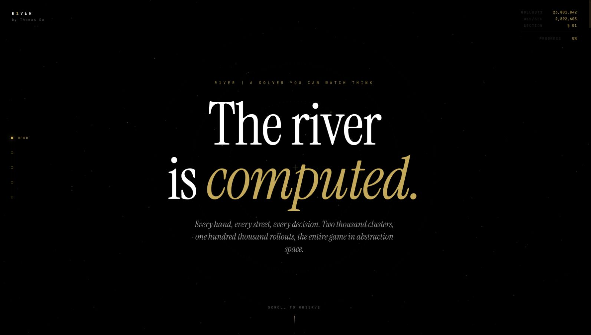

# River | Card Abstraction and Regret Minimization

A Rust research implementation of card abstraction and Monte Carlo counterfactual regret minimization (MCCFR) for heads-up No-Limit Texas Hold'em. It groups card situations and samples game trees to make strategy training smaller than the full game.

The browser interface has been retired. The Rust solver, command-line tools, and local query API remain available. Architecture diagrams preserve the earlier system design.



## Start Here

Start with the [rock–paper–scissors regret check](src/mccfr/rps/blueprint.rs), then read the [shared training loop](src/mccfr/traits/blueprint.rs) and [poker trainer](src/mccfr/nlhe/blueprint.rs). The small game makes the regret calculation easier to inspect before adding poker's card and betting abstractions.

[Run the checks](#run-the-checks) · [Pipeline commands](#pipeline-commands) · [Current limits](#current-limits)

## Method

1. **Represent cards.** Hand evaluation and suit isomorphisms identify equivalent observations. River hand strength is evaluated against uniformly distributed opposing hands, subject to the tie-handling issue below.
2. **Build abstractions.** [Hierarchical clustering](src/clustering/layer.rs) groups observations by distributions over later card states, using Earth Mover's Distance and [optimal transport](src/transport/).
3. **Train and inspect.** MCCFR samples game trees, updates regrets and strategy weights, and writes a *blueprint*: a stored strategy that can be queried through the PostgreSQL-backed API.

The published trainer is fixed to two players, with 100-chip starting stacks and 1/2-chip blinds: 50 big blinds per player. These settings are in [src/lib.rs](src/lib.rs).

## Checks and Evidence

| Artifact | What it checks |
| --- | --- |
| [Rock–paper–scissors test](src/mccfr/rps/blueprint.rs) | The policy-weighted counterfactual regrets are centered on a small game. |
| [Hand evaluation](src/cards/evaluator.rs) and [settlement tests](src/gameplay/showdown.rs) | Specific hand rankings, pot splits, and payout examples. Settlement tests include multiway fixtures; the trainer remains heads-up. |
| [Transport checks](src/clustering/emd.rs) | Numerical properties of the distance calculations. |
| [Criterion benchmarks](benches/benchmarks.rs) | Local timings for hand evaluation, observation enumeration, transport, and the small-game solver. |

There is no committed trained blueprint, opponent-evaluation report, or exploitability estimate. The tests and microbenchmarks do not establish a poker win rate or a Nash-equilibrium result.

## Run the Checks

Install Rust through rustup. [rust-toolchain.toml](rust-toolchain.toml) pins Rust 1.90.0, and [Cargo.lock](Cargo.lock) fixes dependency resolution.

```bash
git clone https://github.com/Smokeybear10/103.RSCH.river.git
cd 103.RSCH.river
cargo test --locked --lib
cargo test --locked --lib --features shortdeck
cargo bench --locked --bench benchmarks -- 'cfr solve rock paper scissors'
```

These commands do not require PostgreSQL or trained data. Exhaustive enumeration and dataset-dependent tests marked `#[ignore]` are excluded from the normal test run. Criterion writes local reports under `target/criterion/`; its timings depend on the machine and fixture.

## Current Limits

The published implementation has correctness gaps that matter before interpreting any trained strategy:

- [Card drawing](src/cards/deck.rs) maps two random indices to the lowest remaining card when more than one card remains, leaving the highest remaining card unselected on that draw and biasing the dealing distribution.
- [River strength](src/cards/observation.rs) excludes tied outcomes instead of assigning half the pot. It is not standard split-pot equity.
- [Blueprint loading](src/mccfr/nlhe/profile.rs) restores strategy values but resets the iteration count. Resuming is not equivalent to an uninterrupted training run.

Depth-limited subgame search is unimplemented, and the training CLI has no run-level seed option. The commands below describe the existing workflow; they do not reproduce a validated playing-strength result.

## Pipeline Commands

Run these stages in order from a fresh checkout. The reduced configuration uses 36 cards, ranks six through ace, with the existing Hold'em rankings. It is not a complete implementation of standard short-deck rules.

```bash
cargo run --release --locked --features "cluster demo shortdeck"
cargo run --release --locked --features "trainer demo shortdeck"
```

`cluster` must finish before `trainer` starts. `demo` reduces clustering iterations and sets a 65,536-tree training budget; even this configuration enumerates card observations and can be expensive. `RAYON_NUM_THREADS` controls parallel workers. There is no `--players` option.

Demo outputs go to `pgcopy/demo/`; other outputs go to `pgcopy/`. These directories do not distinguish deck sizes. Keep the same `demo` and `shortdeck` settings through every stage and use separate checkouts for different configurations. Generated data are gitignored.

To inspect a dataset, start a local PostgreSQL server and use a fresh database for that configuration:

```bash
createdb river_demo
export DB_URL='postgresql://localhost/river_demo'
cargo run --release --locked --features "publish demo shortdeck"
cargo run --release --locked --features "analyze demo shortdeck"
```

The API defaults to `http://127.0.0.1:3002`. In another terminal:

```bash
curl http://127.0.0.1:3002/health
```

The health endpoint checks the abstraction queries for each street. Strategy queries use `POST /blueprint` with `turn`, `seen`, and `past`, as defined in [the request types](src/analysis/request.rs). They require a trained and published blueprint; publishing abstractions alone does not supply a strategy.

## Background

These papers describe the methods and related research, not measured results for River.

1. [Regret Minimization in Games with Incomplete Information](https://papers.nips.cc/paper_files/paper/2007/hash/08d98638c6fcd194a4b1e6992063e944-Abstract.html) — Zinkevich et al., 2007.
2. [Potential-Aware Imperfect-Recall Abstraction with Earth Mover's Distance](https://www.cs.cmu.edu/~sandholm/potential-aware_imperfect-recall.aaai14.pdf) — Ganzfried and Sandholm, 2014.
3. [Solving Imperfect-Information Games via Discounted Regret Minimization](https://arxiv.org/abs/1809.04040) — Brown and Sandholm, 2019.

---

Maintained by Thomas Ou. The Rust package retains its original author credit in [Cargo.toml](Cargo.toml).
