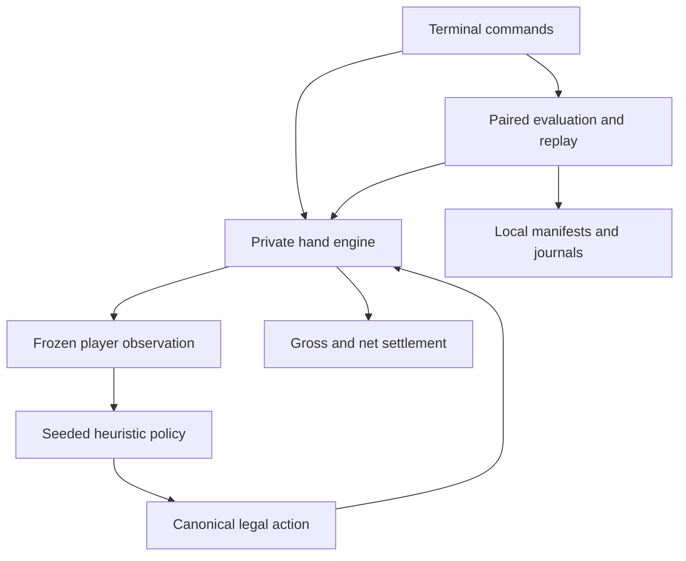
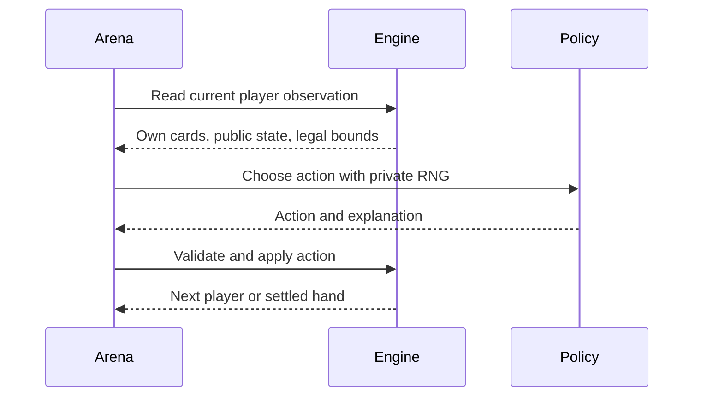
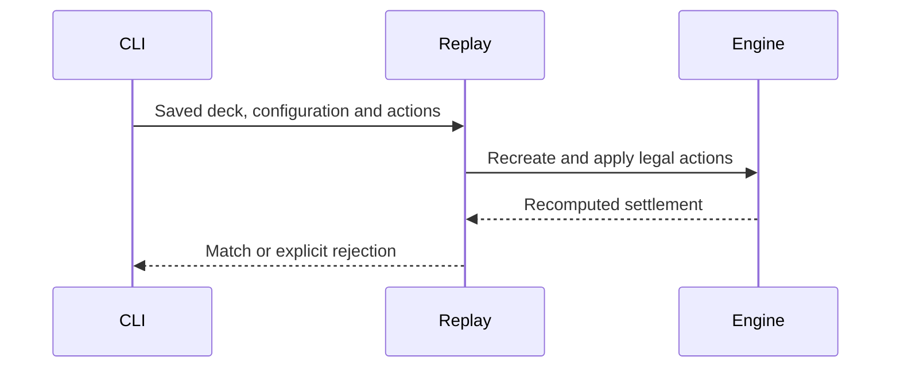
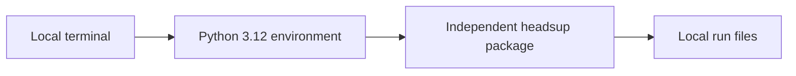

# Heads-Up Poker Lab | Architecture

## System overview

A Python application under River's `lab/` directory plays complete heads-up Hold'em hands, evaluates heuristic policies, and connects separate clients to a private play-money table. Its runtime does not currently consume River's Rust blueprint. PokerKit owns legal game transitions and gross settlement. The engine applies the declared simulated rake once. Policies receive frozen observations containing their own cards and public information. Full decks remain in private host storage for offline replay.



## Components

| Component | Purpose and owned state | Depends on | Location |
|---|---|---|---|
| Models | Validated configuration, immutable action and observation values | Python dataclasses | `headsup/models.py` |
| Engine | Private deck/cursor, rules state, public history, settlement | PokerKit 0.7.7 | `headsup/engine.py` |
| Policies | Private decision RNG, sampled equity before the river, exact conditional river equity, terminal-call rake accounting | eval7 0.1.11 | `headsup/policies.py` |
| Arena | Frozen campaigns, paired outcomes, journals, replay and statistics | Engine, policies, SciPy 1.18.1 | `headsup/arena.py` |
| Terminal | Input parsing, own-card display, command output and human sessions | All components | `headsup/cli.py` |
| Opponent memory | Validated public response counts and contextual Beta estimates | Models, SciPy | `headsup/learning.py` |
| Automatic learning | Training, checkpoints, separate warmup, frozen matched comparison | Arena, memory, policies | `headsup/training.py` |
| Held-out styles | Independently implemented synthetic card-feature policies | Models, eval7 | `headsup/opponents.py` |
| Changing-opponent evaluation | Independent online learning sessions, matched arms, style schedules and session statistics | Arena, training hand loop, profiles | `headsup/adaptation.py` |
| Connection protocol | Strict snapshots, canonical actions, credentials and idempotent receipts | Pydantic, models | `headsup/protocol.py` |
| Private table | Authenticated HTTP endpoints, private decks, atomic game state and receipts, completed replay records | FastAPI, SQLite, engine | `headsup/table.py` |
| Network client | Bot/human terminal actions, pending request recovery, frozen per-hand policy RNG, exactly-once learning | HTTPX, SQLite, policies | `headsup/connection.py` |
| River model | Finite action menu, exact conditional card enumeration, modeled responses and bounded continuation | Adaptive policy, contextual memory | `headsup/river.py` |
| Player database | Identity-scoped profiles, atomic completed-hand updates, restart and duplicate protection | SQLite, POSIX locks, learning | `headsup/opponent_memory.py` |
| Decision worker | Validated observations, persistent policy process, optional saved opponent memory | Protocol, policies, player database | `headsup/decision_worker.py` |
| Browser adapter | Visible-state parsing, bounded session control and confirmed actions | Supplied browser-control interface, decision worker | `headsup/pokernow_*.mjs` |
| Research replication | Independent training seeds, frozen profiles, matched evaluation and portable evidence | Arena, learning, player database | `scripts/run_research.py` |

## Request lifecycles

### Decision and transition: initial targets 500 ms and 20 ms



Decision timing measures `Policy.act`; it excludes imports, construction and engine transitions. Fixed samples before the river and exact conditional river enumeration preserve decision reproducibility. These are usability targets, with no tournament deadline or timing guarantee.

### Replay: initial target 2 seconds per normal hand



Policy replay additionally recreates the recorded policies and RNG seeds and compares actions. It uses current code and dependencies; the campaign manifest preserves their original hashes and versions. A replay verifies internal consistency, not the authenticity of an externally supplied record.

## State topology

| State | Physical home | Lifetime | Failure behavior |
|---|---|---|---|
| Deck, holes and cursor | Private `Hand` fields | One hand | Raw snapshot on failure |
| Public observation | Frozen dataclasses and tuples | One decision | Illegal action rejected before mutation |
| Policy RNG and range weights | Fresh `Policy` per hand | One hand | Rejected proposals and callback timing retained in both play and benchmark modes |
| Campaign identity | `runs/<run>/manifest.json` | Persistent | Existing output path refused; changed source/environment invalidates the result |
| Completed hands | `runs/<run>/hands.jsonl` | Persistent | Flush each leg; partial pairs excluded |
| Scores and timing | `runs/<run>/report.json` | Persistent | Failed and incomplete statuses remain explicit |
| Failure context | `failure.json` or `unfinished-hand.json` | Persistent | Raw engine state avoids recomputing failed settlement |

## Deployment topology



Install with `uv sync --locked`. From this project directory, run `uv run python -m headsup play`, `uv run python -m headsup benchmark --pairs 50`, or `uv run python -m headsup replay runs/<run>/hands.jsonl --hand 1`. Local simulation needs no account or network after dependency installation. GitHub Actions checks Python and JavaScript tests, research artifacts and package builds on Linux and macOS. Publishing source does not deploy a poker service.

## Decision log

| Decision | Reason | Alternatives considered | Date |
|---|---|---|---|
| Independent source and environment | User explicitly separated this from the competition bot | Shared tournament code | 2026-11-05 |
| Terminal-first | User approved the fastest usable arena | Browser interface | 2026-11-05 |
| PokerKit rules, explicit cards | Avoid reimplementing betting rules; keep paired deals reproducible | Custom poker engine | 2026-11-05 |
| Canonical street-total raises | Eliminate additional-chip/raise-to ambiguity | Multiple action dialects | 2026-11-05 |
| Heuristic baseline, labelled honestly | Provides measurable complete-game behavior without unsupported GTO claims | Full neural solver before a working harness | 2026-11-05 |
| Complete pairs as statistical units | Preserve the dependence between seat-swapped hands | Treating every hand as independent | 2026-11-05 |
| Direct net-return vectors | Rake breaks the zero-sum payoff identity | Half the difference between player returns | 2026-11-05 |
| Standard-library regression suites | Durable checks for the requested public research release without another test dependency | Saved one-off checks only | 2026-11-07 |

## Out of scope

The private table implements our own protocol and serves a local browser interface on loopback. Experimental PokerNow modules require a supplied browser-control interface and supervised private play-chip testing; they are not a self-contained deployed client. There is no ClubGG adapter or remote deployment. Cloud training, an unrestricted HUNL solver and profitability claims remain outside this implementation.

## Automatic learning and evaluation

Run `uv run python -m headsup train`. Defaults: 600 hands against each of three training opponents, 600 separate warmup hands for each of three held-out styles, then 128 matched four-game evaluation units per opponent. No manual play is required. `--output` selects a new directory; `--resume` loads its predecessor's checkpoint with a new `--seed` and identical game/source settings.

`checkpoint.json` persists known-opponent profiles atomically after completed training hands. `heldout-warmup.json` keeps unfamiliar-style learning separate and is not merged into the resumed training population. A profile contains public response counts only; no cards, decks, rewards or strategy labels enter it. Policy construction copies the profile. Sparse profiles preserve the baseline's actions and random stream exactly.

`frozen-profiles.json` records the pre-evaluation state. `hands.jsonl` retains actions, settlement, seeds, pre-hand profile snapshots and adaptation explanations, permitting both action and policy replay. Training never consumes evaluation outcomes. Source/environment changes invalidate the run and its checkpoint. Partial training can resume into a new run, but incomplete four-game evaluation units are excluded from estimates.

The report compares direct net returns under matched decks and both seats. Nine predeclared lift endpoints (six opponents and three fixed aggregates) use approximate Student-t intervals with Bonferroni adjustment. Absolute return intervals are descriptive. Uncertainty is conditional on the frozen learned profiles and excludes training variability. Saved candidate memory does not replace the default policy automatically; positive lift does not imply positive absolute return or human profitability.

The separate publication replication in `scripts/run_research.py` retrains each style under multiple independent seeds and exercises SQLite save/restart before frozen evaluation. Its primary interval uses the equal-style aggregate for each training seed as the independent unit, including variation across learned profiles. Pair-level intervals remain diagnostics. `scripts/verify_research.py` checks compact artifact hashes, hand accounting, profiles and recomputed intervals. See `research/REPORT.md` for the exact campaign and limitations.

## Private connections

Run these in separate terminals from the project directory:

```sh
uv run --locked python -m headsup serve --output runs/table --hands 100
uv run --locked python -m headsup connect runs/table/player-0.json --state runs/player-0
uv run --locked python -m headsup connect runs/table/player-1.json --state runs/player-1 --human
```

Omit `--human` to operate the second seat with another bot. Both clients must connect before cards become actionable. The default is 100BB, blinds 1/2, zero simulated rake, adaptive policy with lifetime memory and 128 equity samples. This is a finite match with fresh stacks per hand. Network tables support at most 1000 hands and 1000BB; the 4096-event cap exceeds that depth's legal minimum-raise sequence.

```text
seat credential → GET /v1/state → validate → persist chosen command
    → POST /v1/command → authenticate → deduplicate → check revision/turn
    → commit private state + receipt + completed hand → acknowledge
    → save completed-hand learning once → both players ready → next hand
```

Only the acting player receives an observation, containing that player's cards. Waiting clients receive public actions; neither client receives the opponent's private cards, deck or deck seed. Engine role 0 remains big blind and role 1 remains button. Stable player identities alternate roles; public history retains engine-role coordinates so existing positional learning stays correct.

The host's `table.sqlite3` is the source of truth. Its directory and both credential files are private. Give a participant only their `player-N.json`, never the host directory. Tokens travel in authorization headers and are omitted from access logs. The terminal client requires HTTPS for non-loopback origins and never follows redirects. Internet hosting, TLS termination and remote access setup are not provided by this command.

Disconnects pause the hand. The client retries ambiguous requests for up to 30 seconds, preserving the exact pending command for later recovery. Restart using the same credential file and client directory. To restart the host, use `serve --resume --output runs/table`; it retains its original port, deck, actions and receipts. Client resume requires unchanged code, dependencies and settings. Learning and policy RNG state persist in SQLite; completed-hand acknowledgments prevent missing or double-counting a hand.

`uv run --locked python -m headsup table-export runs/table` writes the host's completed `hands.jsonl`, compatible with the existing `replay` command. Host shutdown also exports it. These files include private decks for offline verification and are never served over HTTP. The network journal verifies submitted actions; it does not claim independent strategy replay or human profitability. Historical training checkpoints retain their original source/environment guards and are not silently migrated by this release.

## Recent memory and independent sessions

`train --memory recent` selects schema-2 public response chronology: last 64 observations per context, first eligible response per context per hand, expiry at 256 completed-hand age. The existing 24-observation gate applies to distinct contributing hands. `--memory lifetime` remains the default and preserves schema-1 behavior. Loading a saved profile never fabricates missing order or ages. Checkpoint resume requires identical memory semantics, source and game configuration; previous version wheels and source archives retain their historical replay environment.

`uv run python -m headsup adaptation` runs the fixed range baseline and both memory models through stationary and switching opponents. Defaults: 12 independent sessions per scenario, 384 hands per arm per session, style switch after 192 completed hands, 128 equity samples. Each hand uses the same fresh deck/policy seeds across arms and alternates hero seats. One stable opponent identity spans the switch; its style and schedule stay outside policy inputs. Each arm starts a separate empty profile every session and updates it only after a complete hand.

`sessions.jsonl` records per-arm returns and final memory. `hands.jsonl` records pre-hand snapshots for both action and policy replay. Partially completed three-arm sessions remain in the journal but are excluded from comparison statistics. Whole independent session differences capture training and evaluation variation together. Four scenarios, two scoring windows and two contrasts plus fixed aggregates produce 20 prespecified adjusted endpoints. No result automatically replaces the prior policy, and this local benchmark does not constitute a real-player test.
